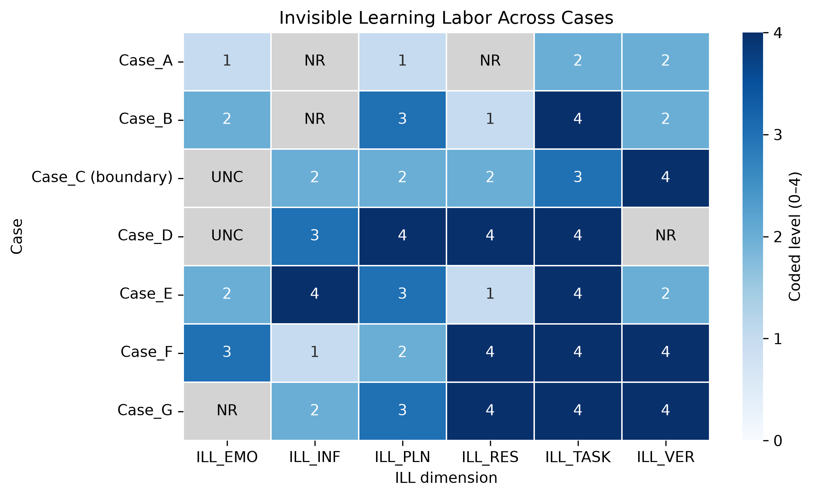
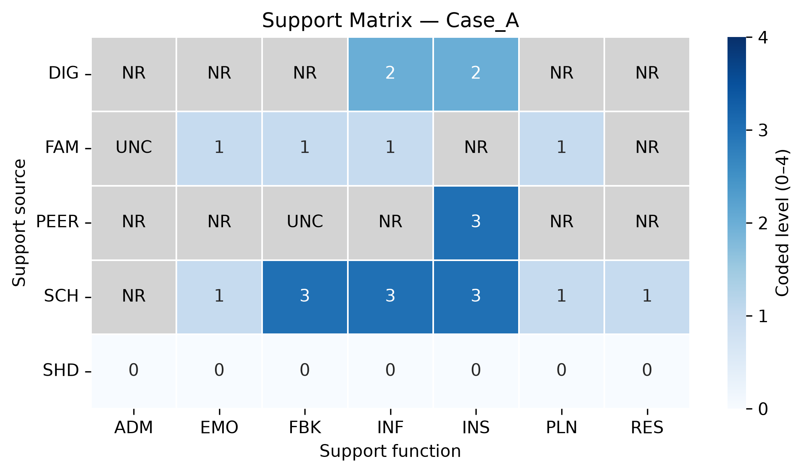
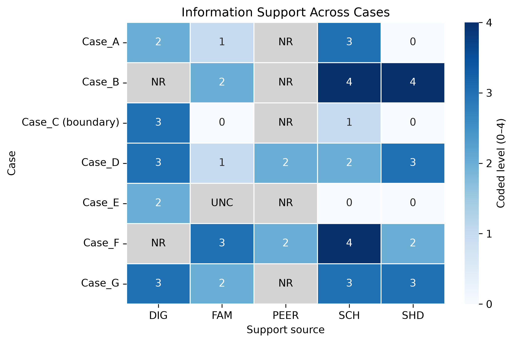

# standardized-test-fairness
## Project Overview

This exploratory qualitative project examines educational support and invisible learning labor in the context of standardized-test fairness. It draws on seven anonymized cases, including one boundary case.

The repository contains a conceptual framework, a codebook, a public derived dataset, retrospective analytic memos, and Python visualizations. The visualizations describe coded patterns across cases and help readers inspect the analysis.

The cases do not form a representative sample. The figures do not establish causal relationships or provide an overall fairness ranking of examinations.
## Repository Guide

| File or folder | Purpose |
| --- | --- |
| [Conceptual framework](conceptual%20framework) | Research concepts and analytical framework |
| [Codebook](codebook) | Variable definitions, coding rules, and evidence quality |
| [Public derived dataset](public%20derived%20dataset) | Anonymized coded records used for visualization |
| [Retrospective analytic memos](retrospective_analytic_memos.docx) | Research reflections and analytical decisions |
| [Analysis notebook](notebooks/01_data_overview.ipynb) | Python plotting steps and descriptive observations |
| [Figures](figures/) | Saved visualization images |
## Provisional Findings

1. **Pathway structure and student strategy jointly shape invisible learning labor.** Similar coded levels can reflect different forms of labor: building a learning system, repairing disrupted support, or pursuing further optimization. Student goals and choices also matter.

2. **Support must be converted into usable, path-relevant action to reduce residual labor.** Repairing, personalizing, interpreting, and integrating support can leave substantial work with the student. Low conversion costs do not necessarily mean low overall learning labor.

3. **Receiving help does not necessarily transfer responsibility.** Support arrangements differ in who owns necessary planning, monitoring, and verification. Continued student monitoring may reflect either retained responsibility or discretionary optimization.

These findings are provisional interpretations from seven qualitative cases. The heatmaps describe coded patterns; they do not independently establish these mechanisms. Coding review and sensitivity checks remain necessary before finalizing the findings.
## Invisible Learning Labor Visualization



Darker blue indicates a higher ordinal coded level within each dimension (0–4). Gray cells indicate NR (not reported) or UNC (unclear), neither of which is treated as 0. Case_C is a boundary case.

The figure describes these seven cases and should not be generalized to all students.

See the [analysis notebook](notebooks/01_data_overview.ipynb) for the plotting steps and initial observation.
## Support Matrix: Case_A



This figure shows coded support levels across sources and functions for Case_A. Codes are ordinal (0–4). Gray cells indicate NR (not reported) or UNC (unclear); neither is treated as 0.

School support (SCH) is coded at level 3 for FBK, INF, and INS. This figure describes Case_A only.
### Other case support matrices

All support heatmaps use the same color scale (0–4) and preserve NR and UNC labels. Case_C is a boundary case.

- [Case_B](figures/case_b_support_heatmap.png)
- [Case_C (boundary)](figures/case_c_support_heatmap.png)
- [Case_D](figures/case_d_support_heatmap.png)
- [Case_E](figures/case_e_support_heatmap.png)
- [Case_F](figures/case_f_support_heatmap.png)
- [Case_G](figures/case_g_support_heatmap.png)
## Information Support Across Cases



This figure compares information support (INF) across seven cases. Support sources are DIG (digital/AI), FAM (family), PEER (peers), SCH (school), and SHD (shadow education).

Codes are ordinal (0–4). Gray cells indicate NR (not reported) or UNC (unclear); neither is treated as 0. Case_C is a boundary case.

School information support is coded at level 4 for Case_B and Case_F, and at level 0 for Case_E. This figure describes these cases only.
## How to Run the Notebook

1. Install Python and the Python and Jupyter extensions in VS Code.
2. Clone this repository and open its root folder in VS Code.
3. Create a virtual environment from the project root:

   ```powershell
   python -m venv .venv
   ```

4. Install the required packages into that environment:

   ```powershell
   .\.venv\Scripts\python.exe -m pip install -r requirements.txt
   ```

5. Open `notebooks/01_data_overview.ipynb` and select `.venv` as its Python kernel.
6. Restart the kernel, then select **Run All** to execute the cells in order.

The notebook uses paths relative to the `notebooks` folder. Keep the repository structure unchanged. Saved heatmaps are written to `figures`; rerunning the saving cells overwrites the corresponding images.
## Development Environment

The notebook was developed using Windows 11 and VS Code with the Python and Jupyter extensions.

Recorded environment:

- Python 3.14.8
- pandas 3.0.6
- Matplotlib 3.11.2
- seaborn 0.13.2